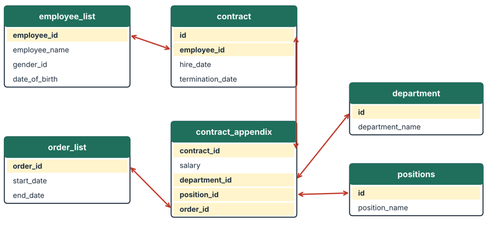

# HR Analytics in Oracle SQL

A small relational database built in **Oracle 21c** to practice SQL on HR data: schema design, data loading, a data quality audit, and business queries.

## What is in this project

| File | Purpose |
|---|---|
| `sql/00_create_user.sql` | Creates the `hr_analytics` user (run once as SYSTEM). Change the password first. |
| `sql/01_schema.sql` | 9 related tables with primary and foreign keys |
| `sql/02_insert_data.sql` | Loads the data (about 100 employees, 5 departments) |
| `sql/03_data_quality_audit.sql` | Checks whether the data can be trusted, then creates a clean view `v_hr_base` |
| `sql/04_business_queries.sql` | 10 business questions: attrition, salary profiles, hiring trend, pay quartiles |
| `sql/05_bonus_example.sql` | A CASE-based bonus scenario by department |
| `sql/06_my_queries.sql` | Practice queries I wrote myself (JOIN, GROUP BY, HAVING) |

## Data quality audit

Before any analysis, the audit looked for problems in the data:

- **13 contracts** where the termination date is earlier than the hire date
- Attendance records where exit time is earlier than entrance time, so working hours cannot be analysed
- Foreign keys that point to rows missing from a lookup table

The clean view `v_hr_base` filters these cases so later queries are not distorted.

## Skills shown

JOIN, LEFT JOIN, GROUP BY, HAVING, CASE, subqueries, CTEs and window functions (in `04`), primary and foreign keys, data validation.

## How to run

1. Connect as SYSTEM to the pluggable database `XEPDB1` and run `00_create_user.sql`.
2. Connect as `hr_analytics` and run the scripts `01` to `05` in order (SQL Developer: open the file, press F5).

## About the dataset and how I built it

The data is a synthetic dataset from a Data Analyst course (Alas Academy), the same one I used for my Power BI dashboard. This is a learning project. I built it with help from an AI assistant: the schema, data load and the advanced queries in `04` (CTEs and window functions) were generated with that help and studied by me. The practice queries in `06` are my own.

## Author

Ali Karimov, Computer Science student at Baku Engineering University.
[LinkedIn](https://www.linkedin.com/in/ali-karimov-505409367)
